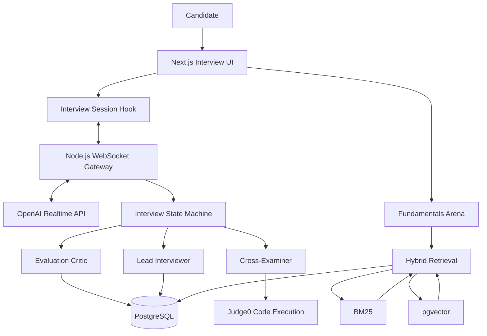

# 🎙️ InterviewAI Studio

### Your AI-powered technical interview, live.

**A voice-first, multi-agent technical interview simulator that listens, challenges your code, and evaluates how you think.**

InterviewAI Studio recreates the experience of a rigorous technical interview with real-time voice conversations, collaborative AI agents, live code analysis, and retrieval-powered computer science questions.

<p align="center">
  
  
  
  
  
</p>

---

## ✨ What makes it different?

Most interview-preparation tools ask questions. **InterviewAI Studio challenges your reasoning as you solve them.**

| 🎤 Real-time interviewer | 🧠 Intelligent code challenges |
|:---|:---|
| Speech-to-speech conversations powered by the OpenAI Realtime API. | A dedicated agent examines code changes and asks targeted follow-up questions. |
| 📝 Structured evaluation | 📚 Context-aware fundamentals |
| A five-axis report with code annotations, transcript insights, and hidden-test results. | Hybrid BM25 + pgvector retrieval for flashcards and scenario-based CS questions. |

## 🚀 Core Features

### 01 · Live Voice Interviewer

- Natural speech-to-speech interaction using the OpenAI Realtime API.
- Tool-driven interview progression across different interview phases.
- Real-time audio capture, playback, and session management.
- A dedicated WebSocket gateway connecting the voice experience to backend services.

### 02 · Multi-Agent Interview System

Multiple specialized agents collaborate to simulate a more demanding technical interview.

- **Lead Interviewer** — manages the conversation, interview pacing, and phase transitions.
- **Cross-Examiner** — inspects code diffs and challenges implementation choices with targeted questions.
- **Evaluation Critic** — evaluates the transcript, code history, and hidden-test results to generate a structured report.
- **Hint Agent** — supports the interview workflow with contextual guidance.

### 03 · Live Coding Environment

- Monaco Editor for an integrated coding experience.
- Dynamic code review based on submitted changes.
- Judge0 CE integration for code execution and test evaluation.
- Visible and hidden test suites for evaluating correctness.

### 04 · AI-Powered Evaluation

Turn an interview session into actionable feedback.

- Five-axis performance report.
- Line-by-line code annotations.
- Evaluation of time complexity, edge cases, and communication.
- Radar-chart visualization of performance.
- Structured output validation using Pydantic and Zod schemas.

### 05 · Fundamentals Arena

Strengthen computer science fundamentals with retrieval-grounded practice.

- Flashcards and scenario-based questions.
- Hybrid retrieval combining BM25 keyword search and pgvector semantic search.
- Reciprocal Rank Fusion (RRF) to combine retrieval results.
- Knowledge-base indexing and embedding generation.

---

## 🏗️ Architecture

The application combines a Next.js frontend, a real-time voice gateway, specialized AI agents, code execution, and a PostgreSQL-backed retrieval system.



For the detailed architecture, sequence diagrams, and state-machine design, see **[Architecture Documentation](docs/ARCHITECTURE.md)**.

## 🧰 Tech Stack

| Layer | Technologies |
|:---|:---|
| Frontend | Next.js 14, React, TypeScript, Tailwind CSS, Framer Motion |
| Code editor & visualization | Monaco Editor, Recharts |
| Voice & communication | OpenAI Realtime API, WebRTC, WebSocket, AudioWorklet |
| AI orchestration | LangGraph, Vercel AI SDK, Zod |
| Language models | OpenAI, Anthropic Claude |
| Backend | Node.js, FastAPI, Server-Sent Events (SSE) |
| Retrieval & embeddings | BM25, RRF, OpenAI embeddings |
| Database | PostgreSQL, Prisma ORM, pgvector, Supabase |
| Code execution | Judge0 CE |
| Validation | Pydantic, Zod |
| Testing & tooling | GitHub Actions, TypeScript, unit tests |

## 📂 Project Structure

```text
app/                  Next.js routes and API endpoints
components/
  arena/              Fundamentals Arena UI
  interview/          Interview room, editor, audio and status UI
  report/              Evaluation report and code annotations
hooks/                 Interview session and audio visualization
lib/
  agents/              Agent prompts, schemas and orchestration
  audio/               Microphone capture and PCM playback
  interview/           State machine, protocol and session tickets
  judge0/               Code execution client
  rag/                  BM25, embeddings, fusion and chunking
prisma/                Database schema, seeds and indexing scripts
content/               Knowledge base and flashcard content
public/worklets/       AudioWorklet processors
server/gateway.ts      Real-time WebSocket gateway
docs/                  Architecture and design documentation
```

## ⚙️ Getting Started

### Prerequisites

- Node.js 20+
- npm
- PostgreSQL with the `pgvector` extension, or Docker Compose
- OpenAI API key with Realtime API access
- Judge0 CE endpoint
- Optional: Anthropic API key

### 1. Clone the repository

```bash
git clone https://github.com/chiksharma221-ui/zettaprep.git
cd zettaprep
```

### 2. Install dependencies

```bash
npm install
```

### 3. Configure environment variables

Create a local environment file from the example:

**Windows PowerShell**
```powershell
Copy-Item .env.example .env
```

**macOS / Linux**
```bash
cp .env.example .env
```

Configure the required values in `.env`, including:

```dotenv
DATABASE_URL=
DIRECT_URL=
OPENAI_API_KEY=
ANTHROPIC_API_KEY=
GATEWAY_SECRET=
JUDGE0_URL=
JUDGE0_API_KEY=
JUDGE0_API_HOST=
```

Use the appropriate values for your database, AI provider, gateway, and Judge0 deployment. Keep all credentials private.

### 4. Start the database

For the bundled PostgreSQL and pgvector setup:

```bash
docker compose up -d
```

Alternatively, configure a PostgreSQL database through Supabase and enable the `vector` extension.

### 5. Initialize
