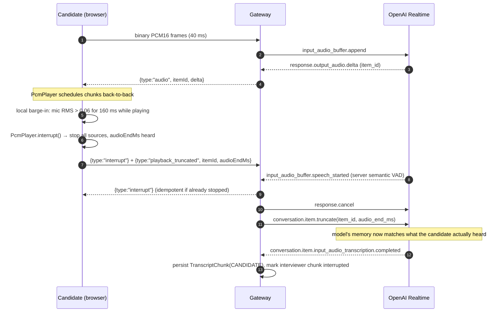
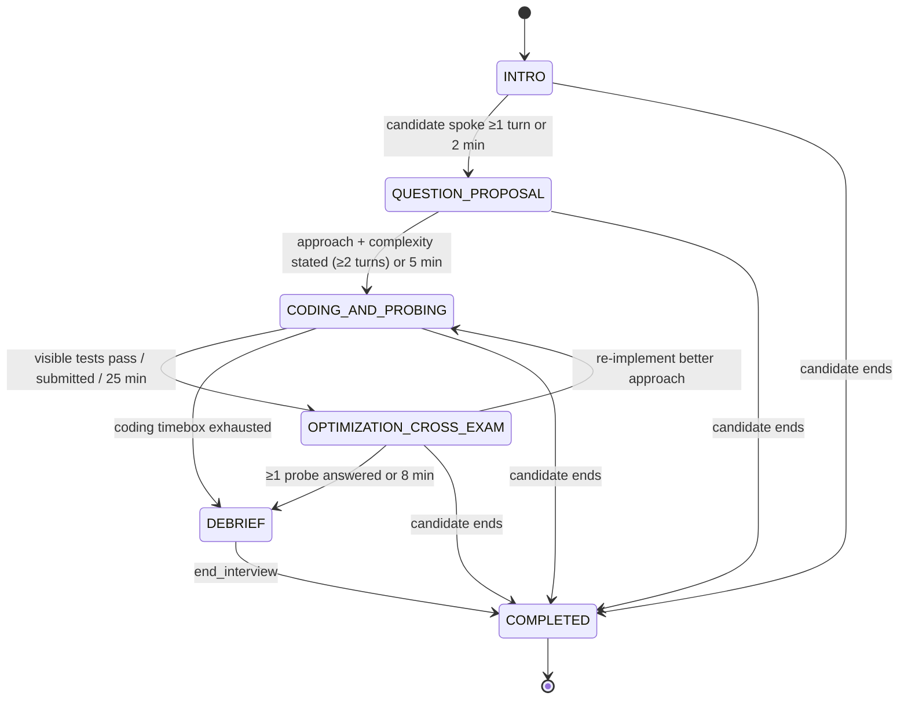
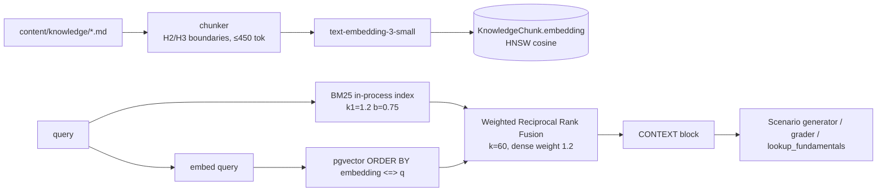

# InterviewAI Studio — Architecture

## 1. System overview

```mermaid
flowchart LR
  subgraph Browser["Browser (Next.js client)"]
    MIC[Mic → AudioWorklet<br/>PCM16 @ 24 kHz]
    PLAY[PcmPlayer<br/>gapless playback + AnalyserNode]
    ROOM[InterviewRoom.tsx<br/>split pane · Monaco · visualizers]
  end

  subgraph Next["Next.js (App Router)"]
    PAGES[Server components<br/>/ · /interview/[id] · /report/[id] · /arena]
    ACT[Server actions<br/>createInterviewSession]
    API[Route handlers<br/>/api/sessions/* · /api/arena/*]
    TICKET[HMAC ticket issuer]
  end

  subgraph GW["Realtime Gateway (Node ws, :3001)"]
    RT[InterviewRuntime<br/>per session]
    SM[Phase state machine]
    XE[Cross-Examiner trigger<br/>debounce · cooldown · dedupe]
  end

  subgraph AI["LLM layer"]
    LEAD[Lead Interviewer<br/>OpenAI Realtime speech-to-speech<br/>tools: advance_phase · get_hint · lookup_fundamentals · end_interview]
    CROSS[Cross-Examiner<br/>generateObject → CrossExamDecision]
    CRITIC[Evaluation Critic<br/>generateObject → Evaluation]
    HINT[Hint generator]
  end

  subgraph Data["Supabase Postgres + pgvector"]
    DB[(User · InterviewSession · TranscriptChunk<br/>CodeSnapshot · Question · EvaluationReport)]
    KB[(KnowledgeChunk<br/>vector(1536) + HNSW)]
  end

  J0[Judge0 CE<br/>sandboxed execution]

  ROOM -- "binary PCM16 + JSON control (WebSocket)" --> RT
  RT -- "audio deltas · transcript · status · probes" --> ROOM
  MIC --> ROOM
  ROOM --> PLAY
  PAGES --> TICKET --> ROOM
  RT <--> LEAD
  RT --> XE --> CROSS
  LEAD -- tool calls --> RT
  RT --> HINT
  RT -- lookup_fundamentals --> KB
  RT -- run / submit --> J0
  RT --> DB
  RT -- on end --> CRITIC --> DB
  API --> CRITIC
  API -- hybrid RAG --> KB
  ACT --> DB
```

**Why a separate gateway?** Next.js route handlers cannot hold long-lived WebSockets. The gateway is a small stateful Node process that owns one `InterviewRuntime` per live interview and shares the same `lib/` code (Prisma, agents, state machine) with the web app.

**Why proxy the Realtime API instead of letting the browser talk to OpenAI directly (WebRTC)?** The Cross-Examiner must inject probes into the *same* conversation, test results must be fed to the interviewer, tool calls must hit our DB/Judge0/RAG, and every utterance must be persisted for the Critic. Doing that server-side keeps hidden tests, reference notes and API keys off the client.

## 2. Realtime voice loop & interruption handling



Two independent interruption paths make barge-in feel instant:
1. **Client-side** energy detection stops playback within ~160 ms without waiting for a network round-trip.
2. **Server-side** semantic VAD (`interrupt_response: true`) cancels generation upstream.

Truncation is the subtle part: without `conversation.item.truncate`, the model believes the candidate heard its full answer.

## 3. Multi-agent loop

| Agent | Runtime | Trigger | Output |
|---|---|---|---|
| Lead Interviewer | OpenAI Realtime (speech-to-speech) | candidate speech, injected system items | audio + tool calls |
| Cross-Examiner | text LLM via `generateObject` | code diff (4 s debounce), spoken claims, test runs | `CrossExamDecision` (Zod) |
| Hint generator | text LLM | `get_hint` tool | `Hint` (Zod) |
| Evaluation Critic | text LLM | interview end (gateway) or HTTP fallback | `Evaluation` (Zod) + deterministic policy caps |

Cross-Examiner guardrails (in `server/gateway.ts` and `lib/agents/cross-examiner.ts`):
- only active in `CODING_AND_PROBING` and `OPTIMIZATION_CROSS_EXAM`
- 40 s cooldown between probes (120 s for low severity), one evaluation in flight, aborted if the candidate starts speaking
- Jaccard de-duplication against previously asked probes
- stale-probe check: dropped if the targeted line changed while the model was thinking
- if the interviewer is mid-sentence the probe is queued and delivered on `response.done`

Probe injection = a `[CROSS-EXAM]` system item + `response.create` with an instruction to ask it in the interviewer's own voice. The UI highlights the target line in Monaco and shows a "Cross-Questioning" status.

## 4. Interview state machine



`lib/interview/state-machine.ts` is pure: `transition()` enforces legal edges for everyone and guards for `LEAD_AGENT`; the candidate and system bypass guards. When the Lead calls `advance_phase` too early, the tool returns the guard message ("No passing run yet…") and the model adapts. A 10 s timekeeper tick emits one nudge per overrun phase. Every transition is appended to `InterviewSession.phaseHistory`, and the Lead's `instructions` are refreshed via `session.update` so the phase directive is always authoritative.

## 5. Hybrid RAG curriculum engine



BM25 catches exact jargon (`TIME_WAIT`, `MVCC`, `xmin`); dense vectors catch paraphrases ("why do my reads see old rows"). RRF fuses ranks so their scores never need calibration. If embeddings or pgvector fail, retrieval degrades to BM25-only.

## 6. Data model

See `prisma/schema.prisma`. Key decisions:
- `TranscriptChunk.offsetMs` and `CodeSnapshot.offsetMs` share a clock (ms since session start), letting the Critic align "I think this is O(n)" with the code at that moment.
- `CodeSnapshot.diff` stores a unified diff per snapshot; `kind` = `EDIT | RUN | SUBMIT` with `runResult` JSON for executions.
- `Question.hiddenTests` and `referenceNotes` never leave the server: `toPublicQuestion()` is the only projection sent to the browser.
- `EvaluationReport` stores the five radar scores as columns (queryable for progress charts) and the full validated payload as JSON.

## 7. Security notes
- Gateway access requires an HMAC-SHA256 ticket (10 min TTL) bound to `(sessionId, userId)`, issued server-side.
- One live socket per session; a newer tab takes over.
- Judge0 submissions: CPU 2 s, wall 5 s, 256 MB, network disabled; source ≤ 64 KB. Expected outputs are compared server-side and hidden I/O is stripped from responses.
- Prompt-injection hardening in the Lead prompt; tool arguments re-validated with Zod in the gateway.
